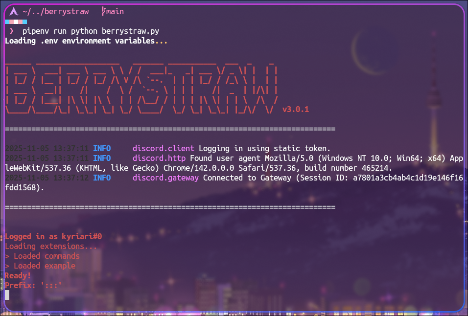

⚠️ Self-bots are not allowed on Discord. Use this at your own risks.
## About
BerryStraw is a self-bot python tool that allows you to add your own commands, to trigger any code. For example, you could control your home smart lights through Discord.
See the `Extensions` section for more information.



## Base features
- (st) Switch theme: toggle between light and dark theme.

## Requirements
- Python 3.10 or higher
- Discord.py must not be installed in the environment
- See requirements.txt for third-party modules requirements

## Installation & Usage
1. Add a .env file containing:
```
PREFIX='COMMANDS_PREFIX'
USER_TOKEN='YOUR_TOKEN'
```
1. `pip install -r requirements.txt`
2. `python berrystraw.py`

## Extensions
Code your own extensions from the template located at `extensions/example.py`. BerryStraw will automatically detect it and load it.
